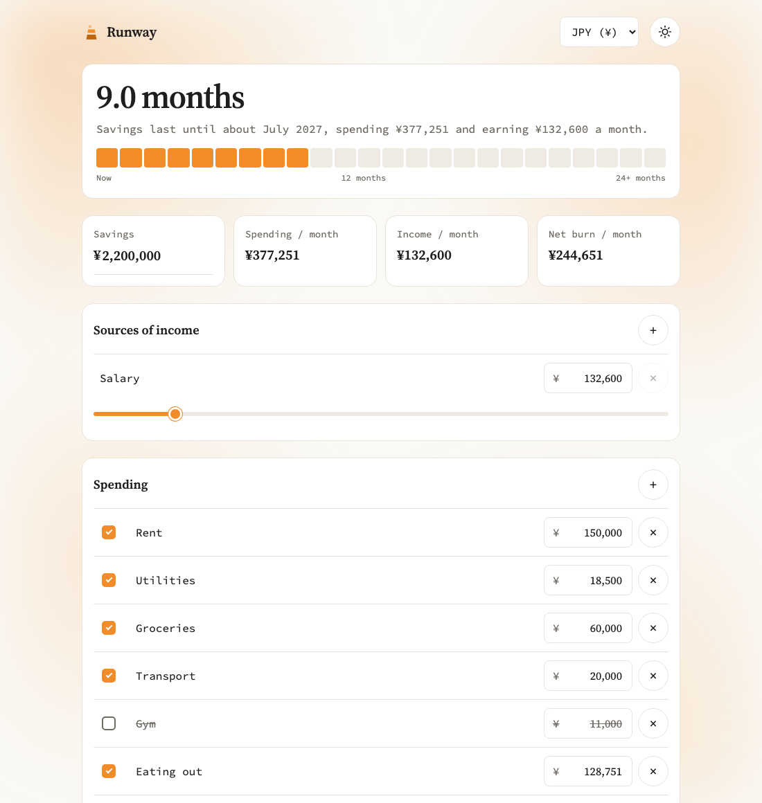
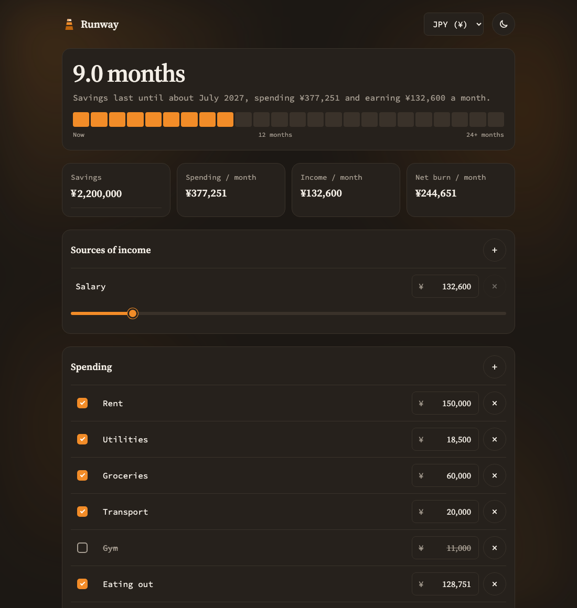
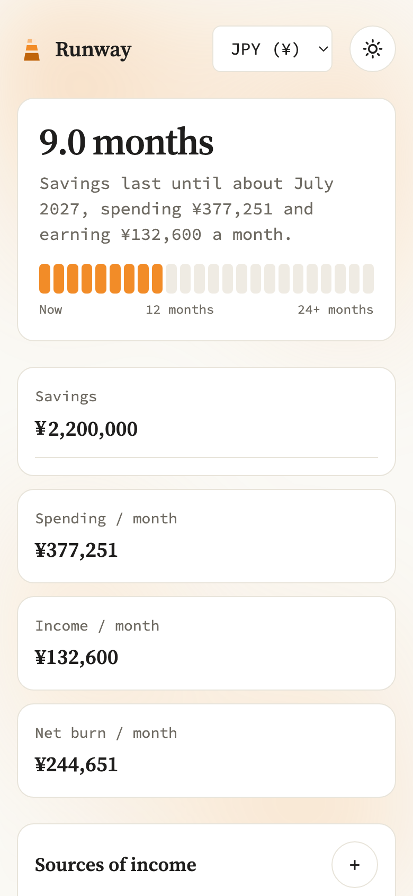

<p align="center">
  
</p>

<h1 align="center">How long is my runway?</h1>

<p align="center">
  Runway shows you how long your savings last.<br />
  Enter your savings, your income and your monthly spending, and see how many months you have left.
</p>

<p align="center">
  <a href="https://myrunway.vercel.app/"><b>Try it at myrunway.vercel.app →</b></a>
</p>

<p align="center">
  <a href="https://github.com/kimikoesc/runway/actions/workflows/test.yml"></a>
  
</p>

<p align="center">
  
  
  
  
  
  
</p>

<p align="center">
  
</p>

## Features

- **Your runway at a glance.** A big "9.0 months", the month your money runs out, and a strip of 24 month blocks that fills up as your runway grows.
- **Income sources.** Add as many as you like. Rename them, then set each amount with a slider or by typing.
- **Spending you can switch off.** Uncheck an expense to see your runway without it, like cancelling the gym or moving somewhere cheaper.
- **Surplus, not just burn.** Earn more than you spend and Runway shows your monthly surplus instead.
- **Five currencies.** JPY (¥), USD ($), EUR (€), GBP (£) and PHP (₱).
- **Light and dark mode.** Follows your device, or tap the sun/moon to choose.
- **Works on your phone.** The layout adapts from a 320px phone to a desktop.
- **Private by default.** Everything stays in your browser. No account, no server, no tracking.

## How to use it

1. **Enter your savings** in the first box under the runway.
2. **Add your income** under *Sources of income*. Tap the name to rename it, and drag the slider or type the amount. Use **+** to add another source.
3. **List your monthly spending** under *Spending*. Use **+** to add an item and **×** to remove one.
4. **Uncheck anything you could cut.** It gets crossed out and left out of the calculation, so you can see how much runway it buys you.
5. **Read your runway at the top.** The strip turns a deeper orange as your runway grows past 6 and 12 months.

Your numbers are saved automatically, so they are still there next time you open Runway.

<p align="center">
  
  &nbsp;
  
</p>

## How the runway is calculated

```
net burn = checked spending − income
runway   = savings ÷ net burn   (in months)
```

If your income covers your spending, your runway is ∞. The run-out date is today plus your runway, shown as a month and year.

## Future features

Right now Runway is purely frontend and stores your data in your browser's local storage. Next up:

- **Accounts and sign-in**, so your numbers follow you across devices.
- **A backend** to save data safely instead of in the browser.
- **Spending categories**, like housing, food and subscriptions, with a total per category.
- **One-off and yearly costs**, such as insurance or a flight home, spread across the months they apply to.
- **Planned income changes**, like a new job starting in three months.
- **Goals**, such as "how much do I need to earn to reach 12 months of runway?"
- **Export** to CSV, so you can keep a copy of your plan.

## Run it locally

Needs Node 20.19 or newer.

```bash
npm install
npm run dev      # start the dev server, open the URL it prints
npm test         # run the tests (watch mode; npx vitest run for a single run)
npm run build    # type-check, then build to dist/
npm run preview  # serve the built app
```

## Project structure

```
index.html                page shell Vite serves
src/main.tsx              mounts <App /> into the page
src/App.tsx               page layout, currency picker, theme toggle
src/App.css               theme color variables + page layout
src/types.ts              shared data types
src/lib/runway.ts         runway math (totals, months, run-out date, strip fills, zones)
src/lib/format.ts         money/date formatting, currency list, slider limit
src/lib/theme.ts          light/dark mode: saved choice or device setting
src/store/runwayStore.ts  the store: state + every action + useRunway() hook
src/store/storage.ts      load/save (localStorage today) + default data
src/components/           reusable pieces: Slider, Checkbox, EditableText, MoneyInput,
                          IconButton, StatCard, Section, RunwayStrip, ThemeToggle
src/features/             page sections: RunwayHeader, StatsRow, IncomeSection, SpendingSection
```

Tests sit next to the code they test (`*.test.ts` / `*.test.tsx`).

### How the code fits together

- **Math** lives in `src/lib/runway.ts`, as plain functions with no React, so it is easy to test.
- **State** lives in `src/store/runwayStore.ts`. Components read it with `useRunway()` and change it only through store actions (`addExpense`, `toggleExpense`, ...).
- **Saving** lives in `src/store/storage.ts`. When the backend arrives, only this file changes: `loadState` and `saveState` call the API instead of localStorage.
- **Themes**: all colors are CSS variables at the top of `src/App.css`. Dark values sit in the `prefers-color-scheme: dark` block and the `[data-theme='dark']` block (keep those two identical).

Every push to `main` runs the type check, tests and build on GitHub Actions (`.github/workflows/test.yml`), and Vercel deploys it to [myrunway.vercel.app](https://myrunway.vercel.app/).

## License

[MIT](LICENSE) © Kimiko Escovilla
